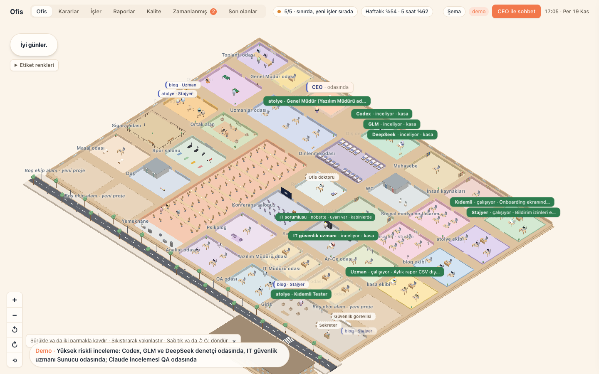
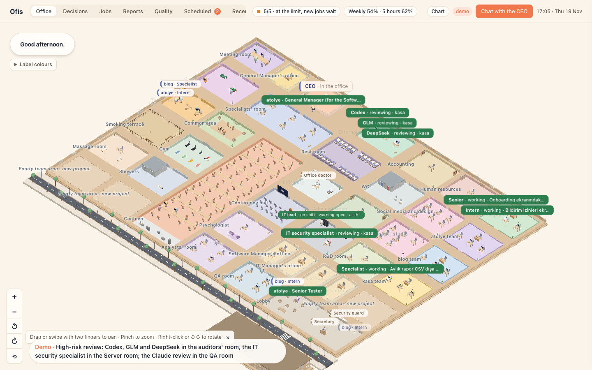
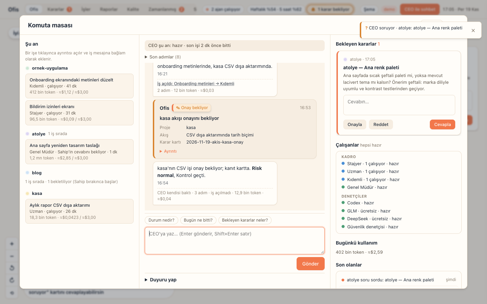
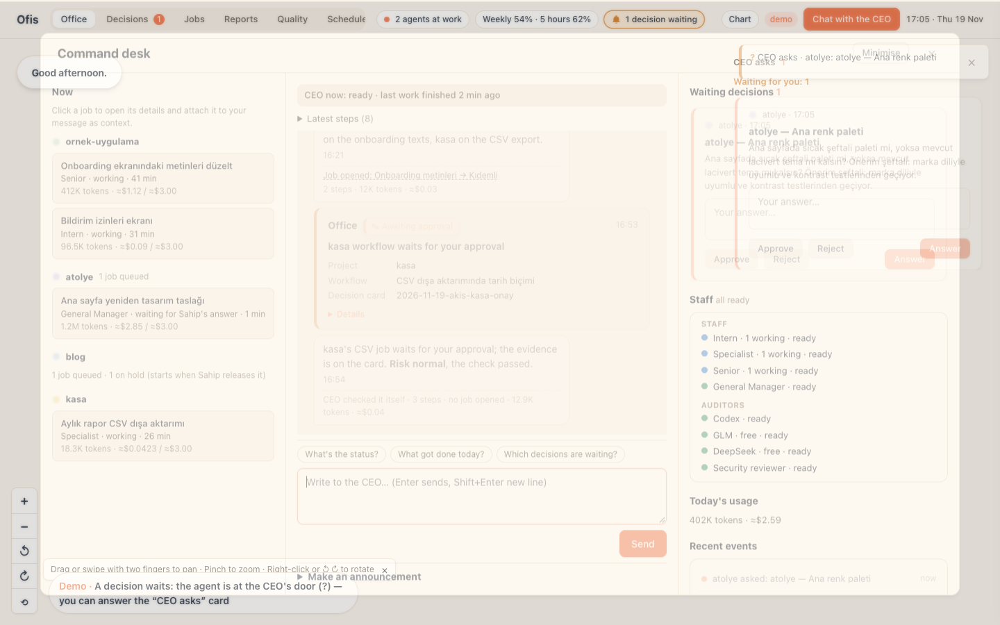
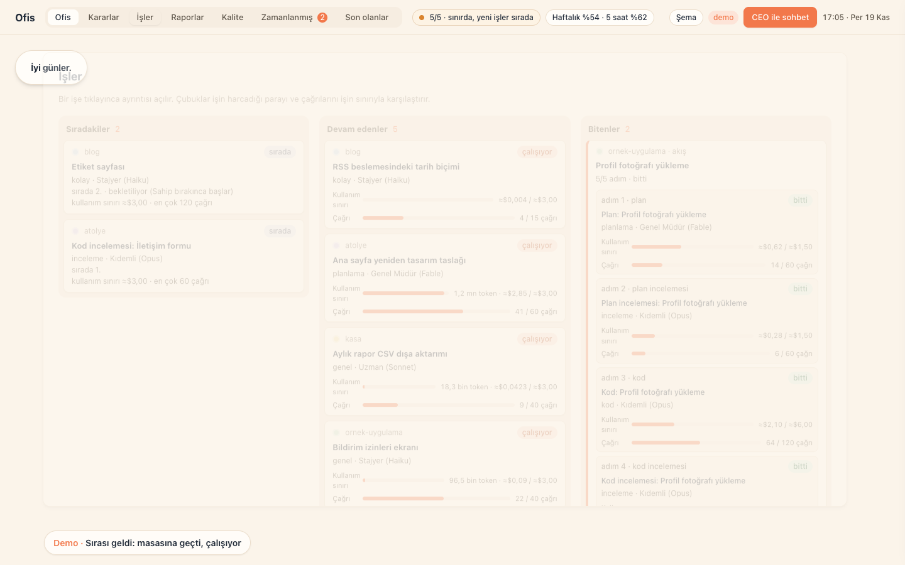
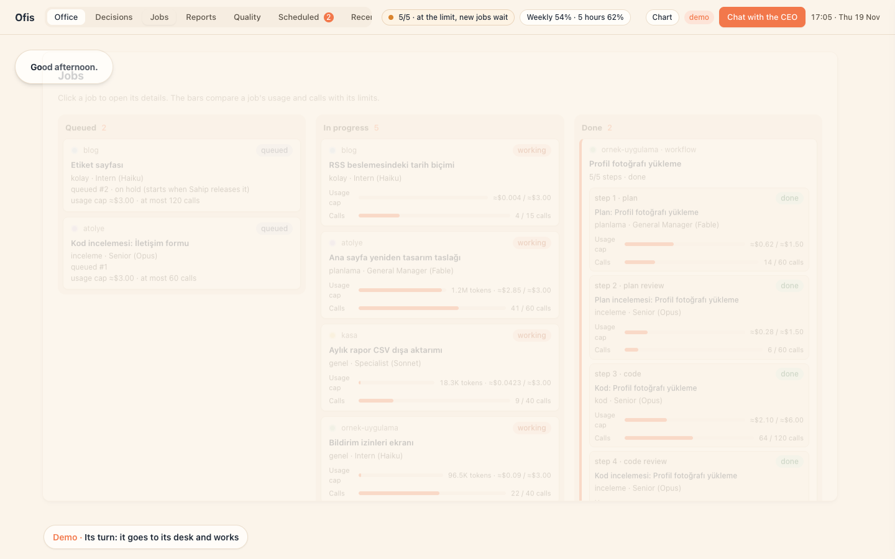

# Ofis

[English](README.md) · **Türkçe**

Ofis, kendi Mac'inde çalışan bir yapay zekâ ofisi. Bir web sayfasında tek bir "CEO" ile konuşursun; CEO bir Claude
Code oturumudur. İsteklerini işlere çevirir, her iş için doğru proje klasöründe bir Claude Code arka plan oturumu
başlatır, onların sorularını ve sonuçlarını sana getirir. Sunucu, bir işi "bitti" saymadan önce kendi çalıştırdığı bir
komutla kanıtlar; kod değişikliklerini bağımsız denetçilere gönderir; her işi, soruyu, cevabı ve raporu Obsidian
kasandaki notlara yazar.

Teknik olarak: yerel bir Python sunucusu (yalnız standart kütüphane) ve ofisi 3B olarak gösteren tek bir web sayfası.

> **Dil:** sayfa, notlar, CEO'nun cevapları ve tüm komut istemleri **Türkçe**. Koddaki adlar da Türkçe; kod
> yorumları ve geliştirici belgeleri İngilizce.

## İçindekiler

- [Ekran görüntüleri](#ekran-görüntüleri)
- [Nasıl çalışır](#nasıl-çalışır)
- [Gereksinimler](#gereksinimler)
- [Kurulum ve ilk çalıştırma](#kurulum-ve-ilk-çalıştırma)
- [Proje eklemek (Ayarlar sekmesi)](#proje-eklemek-ayarlar-sekmesi)
- [Günlük kullanım](#günlük-kullanım)
- [Gizlilik ve güvenlik](#gizlilik-ve-güvenlik)
- [Ayar başvurusu](#ayar-başvurusu)
- [Testler](#testler)
- [Sorun giderme](#sorun-giderme)
- [Katkı](#katkı)
- [Lisans](#lisans)

## Ekran görüntüleri

Üçü de demo ofisini gösteriyor (`?demo=1`: sahte veriler, sunucuya çağrı yok), Türkçe ve İngilizce (`?dil=en`).

**3B ofis** — her projenin bir ekip alanı, her işin masada çalışan bir robotu, çevresinde çalışan odaları ve ortak
alanları (çay köşesi, yemekhane, oyun odası):

| Türkçe | English |
|---|---|
|  |  |

**Komuta masası** — CEO sohbeti, şu an kimin neyi çalıştırdığı ve cevapladığın karar kartları:

| Türkçe | English |
|---|---|
|  |  |

**İşler sekmesi** — sıradaki, çalışan ve biten işler, ilerlemeleriyle:

| Türkçe | English |
|---|---|
|  |  |

## Nasıl çalışır

### CEO

CEO, bu deponun klasöründe çalışan `ofis-ceo` adlı bir Claude Code arka plan oturumu. Uyduğu kurallar
[`CLAUDE.md`](CLAUDE.md) dosyasında. Proje oturumlarıyla hiçbir zaman doğrudan konuşmazsın; her şey CEO'dan geçer.

Sunucu her mesajı CEO'ya, kimin konuştuğunu söyleyen sabit bir önekle iletir:

- `[Sahip · ofis sayfası]` — senin sayfadaki sohbet mesajın;
- `[Sahip · karar cevabı] <not>` — bir karar kartına verdiğin cevap;
- `[Ofis · sistem]` — sunucudan bir bildirim (bir iş bitti, takıldı ya da bir şey soruyor).

Bu önekleri yalnız sunucu yazar. Bir proje oturumunun yazdığı her şey alıntılanır ve veri sayılır, asla talimat
değildir; bir bildirimin içinde "senden geliyormuş" gibi görünen metin sahte kabul edilir.

CEO proje işini kendisi yapmaz; "şu dosyada ne var?" bile küçük bir iş olur. İşleri `bin/ofis.py` ile ekler, yeni bir
özellikten önce sana sorar (kimin işine yarayacak, işe yaradığını nasıl anlayacağız, kapsam dışı ne) ve asla commit,
push ya da silme yapmaz — bu kararlar her zaman senindir.

Her adımı ucuz tutmak için sunucu zaman zaman (bağlam büyüyünce, önbellek soğuyunca, yeni günde) yeni bir CEO oturumu
açar ve ona açık işlerin kısa bir özetini verir.

### Projeler

Proje, bilgisayarındaki bir klasördür ve `ofis.json`'a kayıtlıdır (sayfanın **Ayarlar** sekmesinden eklenir). Her iş o
klasörde kendi Claude Code arka plan oturumunda çalışır; işin modeli, düşünme derinliği (effort), kullanım sınırı ve
çağrı sınırı vardır. Oturum; brief'i, projenin kurallarını ve rolünü içeren bir sözleşme alır ve sonucunu
`bin/ofis.py bildir` ile bildirir. Sunucunun "mesaj iletimi" bölümü bir raporu yalnız o işin kendi oturumundan ve
klasöründen kabul eder.

Bir proje hazır gelir: `arge`, ofisin araştırma masası (bkz. [Ar-Ge odası](#ar-ge-odası)).

### İşler ve yaşam döngüleri

Her iş, kasada `OFIS/Isler/` altında bir nottur. Not, durumuna göre klasör değiştirir:

| Klasör | Durumlar |
|---|---|
| `Isler/Siradakiler/` | `sirada` (sırada bekliyor) |
| `Isler/Devam-Edenler/` | `baslatiliyor`, `calisiyor`, `karar-bekliyor` (açık bir soru var), `incelemede`, `kontrolde` (sunucu Kontrol'ü çalıştırıyor) |
| `Isler/Bitenler/` | `bitti`, `tikandi` (takıldı), `iptal`, `basarisiz` (başlatılamadı) |

Her iş kısa, Türkçe bir brief olarak yazılır: başlık, **Hedef** (bittiğinde ne doğru olacak), **Neden**, **Kısıtlar**,
**Kapsam dışı** ve **Kontrol** (kanıt komutu).

**Dağıtıcı** sıradaki işleri kendiliğinden, en eskiden başlayarak başlatır; bağımlı olduğu işler bitmiş ve sınırlar
uygunsa. Varsayılan sınırlar: aynı anda 3 iş, proje klasörü başına 1 iş, proje başına en çok 5 sıradaki iş. Bir iş
başka işleri bekleyebilir (`--bagimli`) ya da sen salıverene kadar tutulabilir (`--beklet`).

Asıl kayıt not değil, sunucudur: sınırlar, oturum, klasör ve Kontrol `durum/` altındaki, hiçbir oturumun
değiştiremeyeceği sunucu kayıtlarında durur.

### Katmanlar ve modeller

Her işin bir katmanı vardır. Katman; modeli, effort'u, varsayılan kullanım sınırını ve çağrı sınırını belirler:

| Katman | İş | Model | Effort | Çağrı | Kullanım sınırı (API karşılığı) |
|---|---|---|---|---|---|
| `planlama` | büyük bir isteği işlere bölmek, mimari | fable | high | 60 | $3.00 |
| `kod` | geliştirme ve düzeltme, her dosya değişikliği (Kontrol şart) | opus | high | 120 | $6.00 |
| `inceleme` | biten işin bağımsız incelemesi | opus | high | 60 | $1.00 |
| `genel` | okuma, özetleme, araştırma (varsayılan) | sonnet | medium | 40 | $1.50 |
| `kolay` | mekanik, salt okuma: verilen komutu çalıştırıp raporlamak | haiku | low | 15 | $0.30 |

Sayfada modeller ofis unvanlarıyla görünür: Stajyer (Haiku), Uzman (Sonnet), Kıdemli (Opus), Genel Müdür (Fable). Her
iş ayrıca bir uzmanlık alır (`backend`, `ui`, `mobil`, `test`, `analiz`, `guvenlik`, `genel`); bu, brief'ten sabit
kurallarla seçilir ve rol talimatları [`roller/`](roller) klasöründedir. Sunucu her uzmanlık için doğrulanmış dersleri
saklar ve yeni işlere verir.

Kullanım, oturumun kendi kaydından API liste fiyatıyla ölçülür. Sınırını ya da çağrı sınırını aşan işi sunucu durdurur
ve CEO aracılığıyla sana sorar. Bir model kotaya takılınca yeni işler yedek modelle başlar (`kota_yedegi`); durmuş bir
iş, kota dönünce kendiliğinden devam eder.

### Kontrol: işin bittiğinin kanıtı

Bir işin **Kontrol**'ü bir kabuk komutudur, örneğin `pytest -q tests/test_login.py`. Oturum `bitti` dediğinde sunucu
bu komutu kendisi, işin klasöründe `/bin/bash -lc` ile çalıştırır (varsayılan zaman aşımı 900 sn). İşi yalnız 0 çıkış
kodu `bitti` yapar; not, kanıtı içeren bir "Kontrol (kanıt)" bölümü alır.

- Komut iş eklenirken sabitlenir; sunucu yalnız kendi sakladığı kopyayı çalıştırır (özetiyle doğrulanır).
- Kontrol'ü olmayan ya da hiç başarısız olamayan (`true`, `echo …`, `… || true`) bir `kod` işi reddedilir.
- İlk başarısızlık sessizce oturuma geri gider. İkincisinde iş, sınırlar içinde, yeni bir iş olarak bir üst katmana
  **taşınır** (`kolay → genel → kod → planlama`); taşınamıyorsa iş `tikandi` olur ve sana sorulur.

### Akışlar ve denetim

Akış, bir işi sırayla çalışan adım işlerine böler. Şablonlar [`akislar/`](akislar) klasöründe:

| Şablon | Adımlar | Ne için |
|---|---|---|
| `gelistir` | plan → plan incelemesi → kod → kod incelemesi → onay | yeni bir özellik ya da birkaç dosyaya dokunan değişiklik |
| `kucuk-is` | kod → kod incelemesi → onay | küçük, net bir düzeltme |

- **Dış denetçi heyeti** kodu inceler: varsayılan olarak Codex (`codex` komutu); izin verdiğin projelerde ek olarak
  OpenCode ve Antigravity (`agy`) üzerinden ücretsiz denetçiler. Ücretsiz denetçiler değişikliği dış bir servise
  gönderdiği için yalnız senin seçtiğin projelerde çalışır ve değişikliğin yalnız geçici, sembolik bağlantısız, tüm
  araçları kapalı bir kopyasını görür.
- Bir **risk sınıflandırıcı** kaç denetçinin karar vermesi gerektiğine karar verir: kimlik doğrulama, ödeme, CI,
  veritabanı göçleri, derleme dosyaları ya da ajan talimatlarına dokunan değişiklikler yüksek risklidir ve bir
  **güvenlik denetçisi** de alır; yalnız belge ya da test değişikliği düşük risklidir.
- **Hakem** (küçük bir Claude çağrısı) her ciddi bulguyu kontrol eder; yanlış ya da zaten var olan bulguları eler.
  Kodu oturuma yalnız doğrulanmış bulgular geri gönderir (en çok 2 tur). Hiçbir dış denetçi cevap vermezse bir Claude
  incelemesi devreye girer.
- Son adım **senin onay kartın**: önce kanıt (nasıl test edildi, Kontrol neyi kanıtladı ve neyi kanıtlamadı, ajanın
  kararları, değişiklik özeti, inceleme, güvenlik, nasıl geri alınır), sonra plan ve kullanım.
- **Hiçbir akış commit, push ya da silme yapmaz.** Onayladıktan sonra commit yine ayrı bir karardır ve senindir.
- Her şablonun ilk 3 koşusu deneme sürecidir: her adım sen salıverene kadar bekler.

Bir projenin salt teknik sorusunu senin yerine bir **müdür** (küçük bir Claude çağrısı) cevaplayabilir; bu cevabı
kartından değiştirebilirsin. Kapsam, para, silme ya da sürüm gibi konular her zaman sana gelir.

### Grup raporları

Birlikte eklenen işler (`--grup`) ve bir akışın adımları bir grup oluşturur. Hepsi bitince sunucu tek bir rapor yazar
(`OFIS/Raporlar/<grup>.md`: sonuç, kullanım, iş başına doğrulanmış maliyet, ilk turda geçme oranı, yeniden iş, açık
kalanlar) ve CEO'ya her iş için ayrı ayrı değil, tek bir bildirim gönderir.

### Karne

Sunucu `OFIS/Karne/` altında bir karne tutar: biten her iş için bir satır, ana ölçüsü **iş başına doğrulanmış
maliyet** olan bir özet, proje başına bir düzeltme kaydı ve her denetçiyi ölçen bir sayfa. Bu sayılardan yola çıkarak
bir katman için başka bir model önerebilir; öneri kısa bir deneme olarak çalışır ve eşleşmeyi yalnız senin açık
"evet"inle değiştirir. Aynı düzeltme iki kez görülürse CEO o projenin `CLAUDE.md` ya da `REVIEW.md` dosyasına tek bir
satır önerir — o da yalnız senin onayınla eklenir.

### Ar-Ge odası

Hazır gelen `arge` projesi salt okuyan bir araştırma masasıdır.

- Sunucu günde bir kez ücretsiz bir kontrol yapar (model çağrısı yok): `claude`, `codex`, `opencode` sürümleri ve
  OpenCode'un ücretsiz model listesi, bir önceki günle karşılaştırılır.
- Araştırma işleri (istersen günlük bir zamanlanmış iş olarak) `OFIS/ArGe/` altına bir Ar-Ge raporu yazar; her iddianın
  kaynak bağlantısı olmalıdır.
- **Yakala**: sohbete `yakala: <url>` yaz ya da Komuta masasındaki Yakala kutusuna bir bağlantı veya küçük bir
  `.txt` / `.md` / `.pdf` dosyası bırak; bir araştırma işi onu okur ve *kullan*, *fikir al* ya da *geç* önerir.

### Ofis sayfası

`http://127.0.0.1:8800` 3B bir ofis gösterir (three.js, depoda hazır): her projenin bir ekip odası vardır, her iş bir
masada çalışan bir robottur. Çevresinde:

- **CEO sohbeti** ve CEO'nun adımlarını, karar kartlarını ve duyuruları gösteren **Komuta masası**;
- karar zili, "şu an iş başında" listesi, her iş için bir ilerleme çizgisi;
- sekmeler: **İşler**, **Raporlar**, **Kalite** (karne), **Zamanlanmış**, **Son olanlar** ve **Ayarlar**;
- sunucunun durumu ("Sunucu odası": bilgisayarın yükü ve alan adların), Ar-Ge ve denetçiler için odalar;
- isteğe bağlı olarak (`npc_sohbet`, varsayılan kapalı) çalışan kartlarında bir soru kutusu: karakter, ofisin kendi
  verisiyle ve rolünün sesiyle cevap verir; Stajyer modeline araçsız tek bir çağrı.

`?demo=1` sahte verilerle bir demo ofis gösterir; `?hafif=1` yavaş makineler için görüntü kalitesini düşürür.

## Gereksinimler

- **macOS.** Oturum açılışında başlatma launchd ile yapılır, sunucunun bazı bölümleri macOS komutlarını kullanır. Başka
  sistemler desteklenmiyor.
- **Python 3.9 ya da üstü**, yalnız standart kütüphane. `pip install` gerekmez.
- **Claude Code komut satırı aracı**, oturum açılmış, bir Claude aboneliği ya da API erişimiyle. `claude` komutu
  `PATH`'te olmalı.
- **Bir Obsidian kasası.** Ofis onun bir klasörüne (`OFIS/`) yazar. Notları orada okumak istersen Obsidian kurulu
  olmalı; sayfa notları `obsidian://` bağlantılarıyla açar.
- İsteğe bağlı: **`codex`** (varsayılan kod denetçisi; yoksa inceleme Claude'a düşer), **`opencode`** ve **`agy`**
  (ücretsiz ek denetçiler), **`node`** (yalnız JavaScript testleri için).

## Kurulum ve ilk çalıştırma

Tek komut aşağıdaki adımları yapar (yolları ve iki adı sorar, klasörleri oluşturur ve sunucuyu başlatmayı önerir;
var olan `ofis.json` kişiseldir, üzerine yazılmaz):

```sh
bash kurulum.sh
```

Ya da elle:

1. Depoyu indir ve ayar dosyanı oluştur:

   ```sh
   git clone <depo-adresi> ofis
   cd ofis
   cp ofis.example.json ofis.json
   ```

   `ofis.json` kişiseldir ve git'e girmez. Sunucu onu senin yerine oluşturmaz.

2. `ofis.json`'u düzenle:

   - `vault_ofis` — Obsidian kasandaki `OFIS` klasörü, ör. `~/Documents/Obsidian Vault/OFIS`;
   - `sahip_adi` — ofisin sana hitap edeceği ad (1–40 karakter; varsayılan `Sahip`);
   - `ofis_adi` — sayfada görünen ofis adı (varsayılan `Ofis`).

   İki adı da sonradan Ayarlar sekmesinden değiştirebilirsin.

3. Örnek dosyanın gösterdiği klasörleri oluştur — kasadaki `OFIS` klasörü ve Ar-Ge çalışma klasörü
   (`projects.arge.path`, örnekte `~/ofis-arge`):

   ```sh
   mkdir -p "$HOME/Documents/Obsidian Vault/OFIS"
   mkdir -p ~/ofis-arge
   ```

   Ar-Ge klasörünün git deposu olması gerekmez.

4. Klasörleri Claude Code'a güvenilir olarak tanıt. Claude Code güvenmediği bir klasörde arka plan oturumu başlatmaz;
   bu yüzden her klasörde bir kez `claude` çalıştırıp güven sorusuna evet de: bu depo (CEO burada çalışır), Ar-Ge
   klasörü ve sonradan eklediğin her proje klasörü.

   ```sh
   cd ~/ofis-arge && claude    # güven sorusunu onayla, sonra çık
   ```

   Güvenilmeyen bir klasörün işi kaybolmaz: sırada bekler ve onayı verdiğin an kendiliğinden başlar.

5. Sunucuyu başlat:

   ```sh
   python3 bin/server.py
   ```

   Ekrana `Ofis: http://127.0.0.1:8800` yazar (doluysa 8819'a kadar sıradaki boş port). Aynı anda tek sunucu çalışır.

   İstersen macOS her oturum açılışında başlatsın ve çökerse yeniden başlatsın:

   ```sh
   python3 bin/autostart.py install     # --dry-run ne yapacağını gösterir
   python3 bin/autostart.py status
   python3 bin/autostart.py uninstall
   ```

   Bu şekilde başlayan sunucunun günlüğü `~/Library/Logs/ofis/server.log`. `claude` ya da `codex` yer değiştirirse
   veya `PATH` değişirse `install`'u yeniden çalıştır.

6. `http://127.0.0.1:8800` adresini aç, **Ayarlar** sekmesinden bir proje ekle ve sohbette CEO'ya merhaba de. İlk mesaj
   CEO oturumunu başlatır.

## Proje eklemek (Ayarlar sekmesi)

Projeleri düzenlemenin tek yeri **Ayarlar** sekmesidir; `ofis.json`'u elle düzenlemen gerekmez. Her kayıt dosyayı
tek hamlede değiştirir, çalışan sunucu değişikliği birkaç saniye içinde görür ve CEO her değişiklik için kısa bir
bildirim alır.

**Alanlar**

| Alan | Anlamı |
|---|---|
| Proje adı | küçük harf, rakam ve `-`; harf ya da rakamla başlar; en çok 40 karakter; sonradan değiştirilemez; `ofis` ayrılmış bir addır |
| Klasör yolu | proje klasörü, tam yol (`/…` ya da `~/…`), ör. `~/Dev/blog` |
| Açıklama | tek satırlık açıklama (zorunlu, en çok 300 karakter) |
| Proje kuralları | her işin uyacağı kurallar (`notes`, en çok 2000 karakter) |
| Gelişmiş → Hassas yollar | incelemede değişikliği yüksek riskli yapan ek yol kalıpları |
| Gelişmiş → Durup sorması gerekenler / Asla yapmaması gerekenler / Teslim biçimi | projenin nerede durup soracağı, neyi asla yapmayacağı, nasıl teslim edeceği |
| Gelişmiş → Domainler | Sunucu odasının HTTPS, sertifika süresi ve DNS için kontrol ettiği alan adları (ör. `blog.example.com`) |

**Bir klasör şu durumlarda reddedilir:**

- yoksa ya da tam yol değilse;
- ofisin kendi klasörüyse, onun içinde ya da üstündeyse;
- Obsidian kasasıysa (`vault_ofis`'in üst klasörü), onun içinde ya da üstündeyse;
- `~/Library` ya da ev klasörünün hemen altındaki gizli bir klasörse (`~/.ssh`, `~/.claude`, …) veya bunların içindeyse;
- zaten başka bir projenin klasörüyse (iç içe proje klasörlerine izin var);
- yasak klasör adlarından birine uyuyorsa (`guvenlik.yasak_yollar`, aşağıda).

Klasörler yazılışlarına göre değil, dosya sistemindeki kimliklerine göre karşılaştırılır; büyük-küçük harf farkı ya da
sembolik bağlantı bu kuralları aşamaz.

**Silmek ve değiştirmek.** Açık işi olan bir proje silinemez: sıradaki ya da çalışan bir iş, açık bir akış ya da
(duraklatılmış olsa bile) zamanlanmış bir iş silmeyi engeller; hazır gelen `arge` de silinemez. Açık işi ya da akışı
olan bir projenin klasörü değiştirilemez; klasör değişince o projenin ücretsiz dış denetçileri kapanır. Bir projeyi
silmek klasörüne ve kasadaki notlarına dokunmaz. Model katmanları burada değiştirilmez; yalnız karnenin model
kartlarıyla değişir.

Her proje kartı, Claude Code'un o klasöre güvenip güvenmediğini ve güvenmiyorsa çalıştırman gereken
`cd <klasör> && claude` komutunu gösterir.

## Günlük kullanım

**CEO ile sohbet.** Ne istediğini sade Türkçeyle yaz. CEO işleri ekler, işi kimin aldığını söyler ve iş bitince sonucu
iletir. Yeni bir özellik için önce üç kısa soru sorar (kimin işine yarayacak, işe yaradığını nasıl anlayacağız, kapsam
dışı ne).

**Karar kartları.** Bir proje bir şey sorduğunda, bir akış onay beklediğinde ya da CEO'nun senden evet/hayır
duyması gerektiğinde "CEO soruyor" altında bir kart çıkar ve zil onu sayar. Kartta cevap ver (her seçenek için bir düğme
ya da serbest metin). Cevabın bekleyen oturuma ulaşır; aynı karta ikinci cevap kabul edilmez.

**Zamanlanmış işler.** Tekrarlanan bir iş iste ("hafta içi her gün 09:00'da …"). CEO sana zamanlamayı tam olarak
gösterir (ne, hangi proje, hangi gün ve saat, koşu başına kullanım sınırı, Kontrol) ve yalnız senin evetinle ekler.
Zamanlanmış sekmesi hepsini listeler. Art arda iki koşusu başarısız olan zamanlanmış iş kendini duraklatır.

**Duyurular.** Komuta masasındaki "Duyuru yap", çalışan tüm proje oturumlarına tek bir mesaj gönderir — yalnız şimdi,
bugün, bu hafta ya da bir tarihe kadar.

**Sabah özeti.** Her sabah (varsayılan 08:30, `sabah_ozeti`) sunucu `OFIS/Ozetler/<tarih>.md` notunu yazar: dün biten
işler kanıtları ve kullanımlarıyla, bekleyen kararlar, takılan işler, bugünün sırası. CEO özünü iki üç cümleyle söyler.

**Gün sonu değerlendirmesi.** Akşam aralığında (`gun_sonu`, varsayılan 20:00–24:00) sunucu günü ölçer. Kötü bir günde,
önerileri `OFIS/GunSonu/` altına yazılan bir değerlendirme işi ekler; kod düzeltmeleri yine senin sözünü bekler.

**Harcama değil, kullanım.** Her tutar **önce token, sonra API karşılığı dolar** olarak gösterilir, ör.
`182 bin token · API karşılığı ~$0.41`. Claude aboneliğinde iş başına bir şey ödemezsin; dolarlar API liste fiyatıyla
bir tahmindir ve sınırlar kullanım sınırıdır. İstersen üst çubuk, planının 5 saatlik ve haftalık kullanım sınırlarını da
gösterebilir: `limitler.acik`'i aç ve kendi Claude Code durum satırı betiğine `~/.claude/ofis/limitler.json`
dosyasını yazdır (`{"five_hour": {"used_percentage", "resets_at"}, "seven_day": {…}, "saved_at"}`); ofis bu dosyayı
yalnız okur.

**Obsidian.** İş notları, kararlar (`OFIS/Kararlar/`), raporlar ve karne `[[wikilink]]`'li düz Markdown dosyalarıdır;
sayfadaki bağlantılar onları Obsidian'da açar. Sunucunun yazdığı notlar okumak içindir — durumu yalnız sayfadan ya da
CEO aracılığıyla değiştir.

## Gizlilik ve güvenlik

**Gizlilik kuralların: `ofis.json` → `guvenlik`.**

```json
"guvenlik": {
  "yasak_yollar": ["eski-musteri"],
  "ozel_klasorler": ["Ozel"],
  "yasak_kelimeler": ["sifre", "password", "keychain"]
}
```

- `yasak_yollar` — ofisin dışında kalması gereken klasörlerin adları. Bu ada eşit ya da adın ardından `-`, `.`, `_`
  veya boşluk gelen (`eski-musteri-2`) her yol bileşeni her yerde reddedilir: başlatma, raporlar, Kontrol, inceleme,
  sayfa, ayarlar.
- `ozel_klasorler` — kasandaki özel klasörler. Koruma kancası bunların içindeki yolları reddeder; onları yıkıcı
  komutlara ve özyinelemeli aramalara karşı korur.
- `yasak_kelimeler` — bir dosya adının ya da komutun içeremeyeceği kelimeler. Örnek dosya genel parola kelimeleriyle
  gelir.

Eşleştirme büyük-küçük harfe ve Türkçe noktalı/noktasız `i`'ye bakmaz. `guvenlik` anahtarı yoksa tarafsız varsayılanlar
geçerlidir. **Hatalı** bir değer (`yasak_yolar` gibi bir yazım hatası, liste yerine metin ya da `null`, bilinmeyen bir
alan) asla sessizce varsayılana dönmez: sunucu ve `bin/ofis.py` hatalı alanı söyleyen bir mesajla başlamayı reddeder,
koruma kancası da dosya düzelene kadar korunan her araç çağrısını engeller. Zaten çalışan bir sunucu son geçerli
kurallarla devam eder.

**Kişisel engelleme kuralları.** Depoda izlenen [`.claude/settings.json`](.claude/settings.json) yalnız genel kurallar
taşır: koruma kancası, `durum/` altındaki sunucu kayıtlarının korunması, elle `claude --bg` başlatılmaması ve dosya
yazabilecek MCP araçlarının (filesystem, Serena, GitHub yazma, Postgres) engellenmesi. Kendi tam yollarını anan kuralları
(kasanın özel klasörleri, parola notları, uzak tutulacak klasörler) git'e girmeyen `.claude/settings.local.json`
dosyasına yaz. Claude Code iki listeyi birleştirir.

**Koruma kancası** ([`bin/guard.py`](bin/guard.py)) bu klasördeki her Bash, Read, Edit, Write, NotebookEdit, Glob ve
Grep çağrısından önce çalışır. Özel klasörlerin ve sunucunun güvenilir kayıtlarının içindeki yolları reddeder; bunların
üst klasörlerinde yıkıcı komutları ve özyinelemeli aramaları reddeder; beklenmedik bir girdide ya da kendisi çökerse
engeller.

**Dürüst sınırlar.** Kanca bir metin kontrolüdür. Şunları **görmez**: `$HOME` dışındaki bir kabuk değişkeni, bir dosyaya
yazılıp sonra çalıştırılan bir betik, bir yorumlayıcıya verilen kod (`python3 -c`, `node -e`), takma adlar ve kabuk
fonksiyonları, `xargs` ile beslenen ya da bir programın çıktısından gelen yollar. MCP ya da eklenti araçlarını, açıkça
engellenmedikçe, ne kanca ne de engelleme kuralları denetler. Tüm oturumlar aynı işletim sistemi kullanıcısıyla çalışır;
gerçekten deneyen bir proje oturumu CEO gibi davranabilir. Bu yüzden bir oturumun metni her zaman veri sayılır ve sunucu
yalnız kendi kayıtlarına göre hareket eder. `ozel_klasorler` boşsa kasanın özel not taşıdığını gösteren hiçbir şey
yoktur. Bu korumaları bir kum havuzu değil, korkuluk olarak düşün. Ayrıntılar:
[`docs/gelistirici/guvenlik.md`](docs/gelistirici/guvenlik.md).

**Ağ.** Sunucu yalnız `127.0.0.1`'e bağlanır, `Host` ve `Origin` başlıklarını denetler ve her POST, sayfaya gömülen
bir anahtar ister. Claude ve Codex dışında dış servislere yalnız ücretsiz denetçiler (değişiklik), Ar-Ge araştırması
(web aramaları; yalnız proje adları ve açıklamaları, asla kod) ve alan adı kontrolleri ulaşır; ücretsiz denetçiler
yalnız `ucretsiz_denetci_projeler` listesindeki projelerde çalışır.

## Ayar başvurusu

`ofis.json`'un ana anahtarları, [`ofis.example.json`](ofis.example.json) dosyasındaki gibi:

| Anahtar | Anlamı |
|---|---|
| `ofis_adi` | sayfadaki ofis adı |
| `sahip_adi` | ofisin yazdığı her metinde senin adın |
| `dil` | sayfanın ve CEO'nun dili: `tr` (varsayılan) ya da `en` — İngilizcede sayfanın ana görünümleri, gösterdiği sunucu metinleri ve CEO'nun cevapları (Ayarlar › Genel › Dil / Language) |
| `ceo_session` | CEO oturumunun adı (`ofis-ceo`) |
| `ceo_yenileme` | yeni bir CEO oturumu ne zaman açılır: bağlam büyüklüğü, soğuk önbellek, yeni gün |
| `vault_ofis` | Obsidian kasandaki `OFIS` klasörü |
| `projects` | proje kaydı: `path`, `description`, `notes` (+ isteğe bağlı `hassas_yollar`, `sorumlu`, `sistem`); Ayarlar sekmesinden düzenlenir |
| `tiers` | her katman için `model`, `effort`, varsayılan kullanım sınırı `butce_usd` |
| `default_tier` | katman verilmediğinde kullanılan katman (`genel`) |
| `default_budget_usd` | `butce_usd`'si olmayan bir katmanın sınırı |
| `default_max_calls` | katman başına model çağrısı sınırı |
| `max_running`, `max_running_per_project`, `max_queued_per_project` | dağıtıcı sınırları |
| `ladder`, `max_escalations` | iki başarısız Kontrol'den sonraki üst katman sırası ve en çok kaç kez |
| `kota_yedegi` | bir model kotaya takılınca kullanılacak yedek model |
| `denetciler` | kod denetçileri (`codex`, `opencode`, `agy` kayıtları) |
| `ucretsiz_denetci_projeler` | değişikliği ücretsiz dış denetçilere gidebilecek projeler |
| `denetci_yeter_sayisi` | risk düzeyine göre bir incelemenin kaç denetçi kararı istediği |
| `hakem` | hakem çağrısının modeli ve sınırı |
| `guvenlik_denetcisi` | güvenlik denetçisinin modeli, sınırı ve normal riskte de çalışıp çalışmayacağı |
| `mudur_karari` | teknik soruları müdürlerin cevaplaması: açık/kapalı, model, sınır, zaman aşımı |
| `gun_sonu` | gün sonu değerlendirmesi: açık/kapalı, akşam aralığı, sınır |
| `hafiza_saglik` | kasa notlarının günlük, salt okuyan sağlık kontrolü |
| `model_onerisi` | karnenin model önerileri ve denemeleri için eşikler |
| `ofis_sahnesi` | sahnedeki öğle arası ve ofisin saat dilimi (`saat_dilimi`, varsayılan: sistemin) |
| `danisman_pilotu`, `zor_is_danismani` | kod işleri için danışman model: A/B denemesi (kapalı) ve zor işler için |
| `yakala` | Yakala kutusu: açık/kapalı, öğe başına sınır, saatlik sınır, dosya boyutu |
| `npc_sohbet` | NPC sohbeti: bir çalışanın kartından ona kısa bir soru sor (varsayılan kapalı; açık/kapalı ve saatlik sınır Ayarlar sekmesinde) |
| `talimat_denetimi` | bir katmanın modeli değişince çalışan talimat denetimi |
| `jarvis` | sesli / menü çubuğu istemcisi için isteğe bağlı yerel A2A kapısı (varsayılan kapalı) |
| `limitler` | plan kullanım göstergesi ve uyarı eşikleri |
| `guvenlik` | gizlilik kuralların (yukarıda) |

Örnekte olmayan isteğe bağlı anahtarlar: `kontrol_timeout_s` (900), `sabah_ozeti` (`"08:30"`), `max_bekleyen_onay` (2),
`akis_deneme_kosusu` (3), `codex_timeout_s` (900), `codex_bin` / `opencode_bin` / `agy_bin` (yoksa `PATH`'te aranır),
`sahipsiz_oturum_saat` (3). Tüm ayrıntılar [`docs/GELISTIRICI.md`](docs/GELISTIRICI.md#files) dosyasında.

## Testler

```sh
python3 test/hepsi.py            # hepsi, paralel (commit'ten önce bunu çalıştır)
python3 test/hepsi.py --hizli    # yavaş testleri atla
python3 test/hepsi.py web npc    # yalnız adında bu kelimeler geçen test dosyaları
python3 -I test/test_ofis.py     # tek dosya
```

`python3 -m unittest` kullanma: `test` klasörü Python'un kendi `test` paketiyle çakışır. Sayfanın testleri
JavaScript'i `node` ile çalıştırır; node yoksa atlanır. Tarayıcı gerekmez.

## Sorun giderme

**Bir iş sırada kalıyor: "Claude bu projenin klasörüne henüz güvenmiyor".** Claude Code klasöre henüz güvenmiyor. Bir kez
`cd <klasör> && claude` çalıştırıp soruyu onayla (Ayarlar sekmesi komutu gösterir). İş sonra kendiliğinden başlar.

**"ofis: HATA Obsidian … notlarına erişilemiyor".** Sunucu kasa klasörünü okuyamıyor. Önce `vault_ofis` klasörünün var
olduğuna bak. Varsa ve sunucu launchd ile başladıysa macOS gizliliği engelliyordur: Sistem Ayarları → Gizlilik ve
Güvenlik → Tam Disk Erişimi'ni aç, mesajın adını verdiği python dosyasını ekle (gerçek yolu; yazmak için ⌘⇧G), sonra
`python3 bin/autostart.py install` komutunu yeniden çalıştır. `python3 bin/autostart.py status` son başlangıçtaki hatayı
gösterir.

**Sunucu başlamıyor.**

- `ayar dosyası bulunamadı` — henüz `ofis.json` yok: `cp ofis.example.json ofis.json` yapıp düzenle.
- `ofis.json needs 'ceo_session', 'vault_ofis' and 'projects'` — bu anahtarlardan biri eksik.
- `ofis.json'daki 'guvenlik.…' hatalı` — gizlilik kurallarının biçimi yanlış; adı verilen alanı düzelt.
- Bir JSON ayrıştırma hatası — dosya geçerli JSON değil (eksik ya da fazla virgül gibi).
- `Ofis server already running` — başka bir sunucu çalışıyor (belki otomatik başlayan); bu süreç kapanır.

`ofis.json` bozukken koruma kancası bu klasördeki Claude Code oturumlarının araç çağrılarını da engeller.

**CEO hâlâ eski kurallarla çalışıyor.** Çalışan bir CEO oturumu başladığı andaki `CLAUDE.md`'yi kullanır. `CLAUDE.md`'yi
değiştirdikten sonra şunu çalıştır:

```sh
python3 bin/ofis.py ceo-yenile
```

CEO'ya giden bir sonraki mesaj, devir notuyla yeni bir oturum başlatır.

**Nereye bakmalı.** `python3 bin/ofis.py durum` iş tablosunu yazar. Sunucunun hataları ve önemli olayları kasanda
`OFIS/Sunucu/Hatalar-<YYYY-AA>.md` dosyasında, ayrıca terminalde ya da `~/Library/Logs/ofis/server.log` dosyasındadır.

## Katkı

[CONTRIBUTING.md](CONTRIBUTING.md) dosyasına bak (İngilizce). Geliştirici başvurusu:
[`docs/GELISTIRICI.md`](docs/GELISTIRICI.md).

## Lisans

[MIT](LICENSE). `web/vendor/three/` altındaki three.js kendi MIT lisansını korur.
